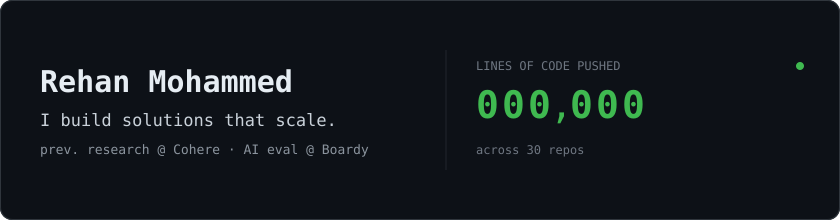

I build solutions that scale. Previously did research at **Cohere** and AI evaluation at **Boardy**.

I've built across **voice**, **debugging and evaluation**, **multi-agent systems**, **brain-computer interfaces** and **computer vision**.

> **What I believe:** obsession can win you the world.

**Stack:** Python · TypeScript · Next.js · Postgres · LangGraph · MCP

📫 rehanmoin91@gmail.com
