### Hi, I'm Rehan 👋

I build reliability tooling for AI agents: finding out **why** an agent did the wrong thing, and making sure it stays fixed.

### What I'm working on

- **[runtape](https://github.com/RehanMohammed985/runtape)** : counterfactual debugging for AI agents. It reruns a bad decision without each piece of context to find the cause, tests candidate fixes, and writes a regression test. Listed in [Awesome-LLMOps](https://github.com/tensorchord/Awesome-LLMOps/pull/875).
- **Multi-agent research**: [selective communication](https://github.com/RehanMohammed985/Selective-Communication-in-Multi-agents) and [scalable coordination](https://github.com/RehanMohammed985/scalable-marl-coordination) in multi-agent RL.

### Other projects

- **[advance-cube-solver](https://github.com/RehanMohammed985/advance-cube-solver)**: scans a Rubik's cube with a webcam, solves it, and guides each move with AR overlays.
- **[cursor-mobile-bridge](https://github.com/RehanMohammed985/cursor-mobile-bridge)**: control Cursor on your Mac from Discord on your phone.

### Background

Co-founded a startup, published research, and shipped production software at other companies.

**Stack:** Python · TypeScript · Next.js · Postgres · MCP

📫 rehanmoin91@gmail.com
